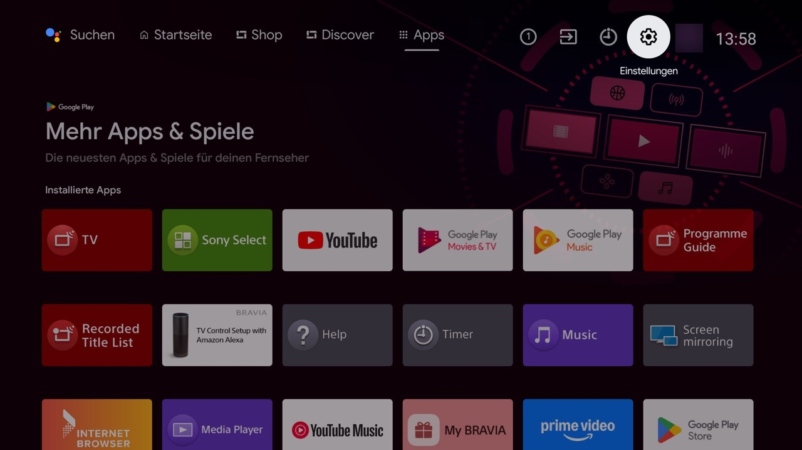
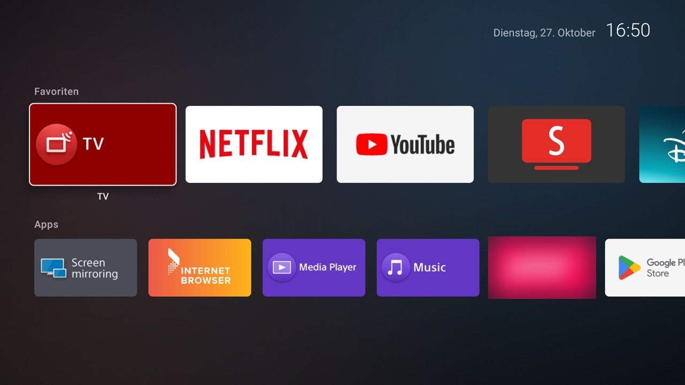

# OpenShelf TV

A faster, ad-free home screen for Android TVs, a cleanup tool for the bloat that ships on them, and AirPlay so iPhones and Macs can mirror to the TV.

It does not replace the TV's operating system. It runs on top of Android TV: a new home screen app, a few switched-off system apps, and an open-source AirPlay receiver. Everything can be undone.

| Before: Sony's stock home screen | After: OpenShelf |
|---|---|
|  |  |

Both screenshots are from the test TV, which is set to German. One app tile and the profile icon are blurred.

## What you get

- **OpenShelf home screen.** Rows of real app banners (Favourites, Apps, HDMI inputs, System), a calm dark background that picks up the colour of the focused app, a clock. No recommendations, no ads, no network access at all. On the test TV it uses about 23 MB of memory, against 176 MB for the stock home screen, and starts in under half a second.
- **Cleanup lists.** Plain text lists of system packages to switch off: ad and tracking services (Samba TV on Sony), promo tiles, shop demo mode, hotel/business services, preloaded extras. Every line has a comment saying what it is. Packages are disabled with `pm disable-user`, never deleted.
- **OpenShelf Keeper (optional).** A small app that checks after every boot that the listed apps are still off, and switches them off again if a firmware update turned them back on.
- **AirPlay.** Uses the open-source receiver [jqssun/android-airplay-server](https://github.com/jqssun/android-airplay-server). Screen mirroring from iPhone, iPad and Mac with the built-in Screen Mirroring button, no app on the phone. An optional patch makes the TV go back to whatever was on screen before (an app, live TV, the home screen) when you stop mirroring.
- **One command-line tool** (`tools/openshelf.py`, Python, no dependencies) for backup, audit, apply, undo, health checks and settings. Works on macOS, Linux and Windows.

Measured on the test TV (Sony KD-55XG8096, 2 GB RAM), 60 seconds after a restart: free memory went from 537 MB to 778 MB.

## Which TVs

| Device | Status |
|---|---|
| Sony BRAVIA 2019 Android TV 9 (XG80, XG85, XG95 and similar) | Tested. Ready-made cleanup lists in `lists/sony-bravia-2019/`. |
| Other Android TV sets (Philips, TCL, Hisense, Sharp, other Sony years) and boxes (Nvidia Shield, Chromecast with Google TV) | Home screen, keeper, AirPlay and the tool work. You need a cleanup list for your model: `openshelf.py audit` shows what is installed. See [lists/README.md](lists/README.md). |
| Google TV models (2021+) | Possible, but replacing the home screen is harder; Google TV can take Home back. Read [docs/troubleshooting.md](docs/troubleshooting.md) first. |
| Amazon Fire TV with Fire OS | Android-based, untested. The tool and AirPlay should work; home screen replacement is restricted by Amazon. |
| Samsung (Tizen), LG (webOS), Roku | Not possible. These are not Android TV. |

## Quick start

You need a computer on the same network as the TV, [Android platform-tools](https://developer.android.com/tools/releases/platform-tools) (`adb`) and Python 3.9 or newer.

1. Turn on network debugging on the TV: [docs/setup-tv.md](docs/setup-tv.md).
2. Connect and take a backup:
   ```bash
   export TV_HOST=<your TV's IP address>
   python3 tools/openshelf.py connect
   python3 tools/openshelf.py backup
   ```
3. See what would change, then apply:
   ```bash
   python3 tools/openshelf.py audit
   python3 tools/openshelf.py apply lists/sony-bravia-2019/01-tracking-ads-demo.txt --dry-run
   python3 tools/openshelf.py apply lists/sony-bravia-2019/01-tracking-ads-demo.txt
   ```
4. Build and install the home screen, then switch off the stock one: [docs/install.md](docs/install.md).
5. Check that everything still works: `python3 tools/openshelf.py check`.

On Windows use `py` instead of `python3` and `set TV_HOST=...` instead of `export`.

## Using a coding agent

The whole setup can be done by a coding agent such as Claude Code. Open this folder in the agent and tell it:

> Follow docs/agent-runbook.md to set up my TV.

The runbook has the order of steps, the checks after each one, and the points where the agent has to stop and ask you (for example before changing anything on the TV, and for the prompts you must accept with the remote).

## Undo

Every package the tool disables is logged in `backups/undo.txt`.

```bash
python3 tools/openshelf.py restore
```

If the keeper is installed, uninstall it first, otherwise it switches the apps off again after the next restart. Without a computer, any app can be switched back on under Settings > Apps on the TV. Details: [docs/safety-and-undo.md](docs/safety-and-undo.md).

## Things to know

- ADB debugging has to stay on if you use the keeper. Only computers you approved on the TV can connect.
- After switching apps off, wait at least 30 seconds before restarting the TV. Android saves the change with a short delay; a restart straight away can lose it.
- The menu layer of most Android TVs is drawn at 1920x1080 even on 4K panels. Video, including AirPlay, still plays in 4K.
- Copy-protected apps (Apple TV+, Netflix on the phone) cannot be mirrored over AirPlay. That is an Apple limit.
- Ad-blocking DNS (`openshelf.py tweak dns adguard`) blocks ad servers for the whole TV but can break ad-funded streaming apps. It is off unless you turn it on.

## Folder layout

```
apps/home/           OpenShelf home screen (Java, builds without Gradle)
apps/keeper/         OpenShelf Keeper boot-time safety net
apps/airplay-patch/  patch script for the open-source AirPlay receiver
lists/               cleanup lists per TV model
tools/openshelf.py   command-line tool
tests/               tests for the tool
config/              default app list for health checks
wallpaper/           generator for the home screen background
docs/                setup, install, agent runbook, troubleshooting
```

## Contributing

Lists for other TV models are the most welcome addition. See [.github/CONTRIBUTING.md](.github/CONTRIBUTING.md).

## License and credits

PolyForm Noncommercial 1.0.0. You may use, change and share this for free for any noncommercial purpose. Selling it, or putting it or a modified version behind a paywall, is not allowed. See [LICENSE](LICENSE).

Third-party projects this builds on (not included here, each under its own license):

- [jqssun/android-airplay-server](https://github.com/jqssun/android-airplay-server), GPL-3.0. The patch script modifies your own downloaded copy; if you share the patched APK, the GPL applies to it.
- [Apktool](https://github.com/iBotPeaches/Apktool), Apache-2.0, used by the patch script.
- [SmartTube](https://github.com/yuliskov/SmartTube), MIT, recommended for YouTube without ads.
- [Gathin23/cleanyourtv](https://github.com/Gathin23/cleanyourtv), whose model lists were a reference for the Sony lists.
- AdGuard DNS (dns.adguard-dns.com), a free public DNS service.

Sony, BRAVIA, AirPlay and other names are trademarks of their owners. This project is not affiliated with any of them.
